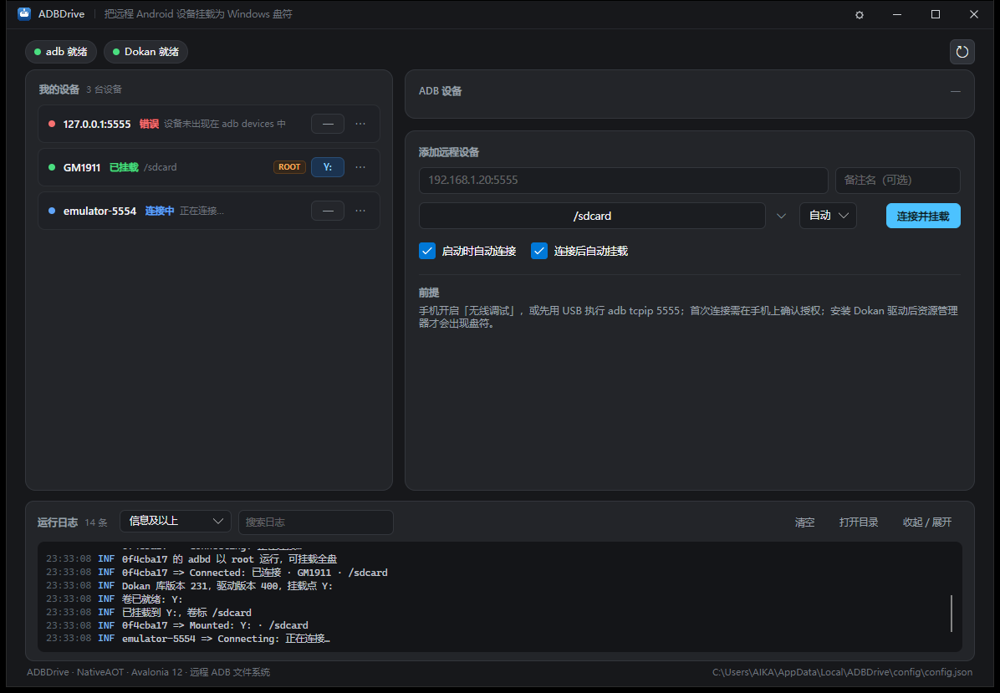
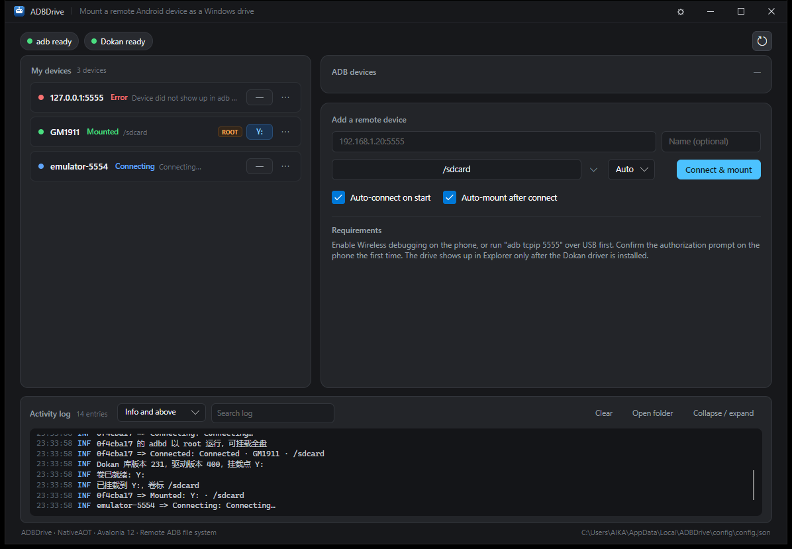

# ADBDrive

把**远程**（无线 / `adb connect`）Android 设备挂载成 Windows 盘符的桌面工具。
挂载后资源管理器「此电脑」里会多出一个磁盘，可以像本地磁盘一样浏览、复制、粘贴、重命名、删除。

- UI：Avalonia 12.1.6（Fluent 深色）+ .NET 11
- 文件系统：Dokan 2.x（用户态文件系统驱动）
- 通信：直连本机 ADB server 的 socket 协议（`127.0.0.1:5037`），不逐条起 `adb.exe` 进程
- 发布：NativeAOT（win-x64 单文件，无 .NET 运行时依赖）



## 为什么需要它

USB 连接时 Windows 原生 MTP 就能看到手机文件；但 `adb connect <ip>:5555` 这类远程无线场景下，
资源管理器完全看不到设备。本工具填补这块空白：它不做 ADB 客户端，只把文件系统语义映射成盘符。

## 功能

| 能力 | 说明 |
| --- | --- |
| 远程连接 | 输入 `IP:端口` 发起 `adb connect`，支持多设备同时挂载到不同盘符 |
| 设备发现 | 读取 `adb devices -l`，一键挂载已连接的设备 |
| 挂载管理 | 自动分配盘符或手动指定，支持卸载 / 重新挂载 |
| 设备列表 | 一行一台设备：状态点 + 名称 + 状态 + 挂载根，右侧盘符徽标和 `⋯`；操作收进 `⋯` 菜单，多设备时不占地方。徽标只有一种含义——已挂载时点它打开资源管理器，未挂载就只是个灰底 `—`，不可点 |
| 设备名称 | 按「备注 → 机型名 → 端点」取第一个可用的，只显示一个；悬停可看「机型名 · 序列号」完整信息 |
| 设备设置 | 点设备行空白处展开 / 收起，或 `⋯` →「设备设置」，行内改备注 / 盘符 / 挂载根；备注即时生效，挂载根变了才「卸载→换根→重挂」，盘符字母不变 |
| root 感知 | 连接时检测 adbd 身份，root 设备显示 ROOT 徽标，可挂载全盘 |
| 文件操作 | 目录枚举、流式读写、删除、重命名/移动、建目录、改时间、属性 |
| 断线降级 | 设备离线时操作**立即**失败（不卡资源管理器），后台按退避策略自动重连 |
| 缓存 | 目录列表 / 元数据 TTL 缓存，显著减少 ADB 往返 |
| 配置持久化 | 设备地址、挂载根、盘符偏好、自动连接/自动挂载；改完即时存盘，无需重新添加设备 |
| 日志 | 界面实时日志 + 按天滚动文件；整行（时间戳 + 级别 + 消息）是同一个可选文本面，可自由拖选、精确到字符，Ctrl+C 复制选中、Ctrl+Shift+C 复制全部、Ctrl+A 全选，右键「复制所选 / 复制全部」；支持关键字搜索过滤（按消息 / 分类 / 级别匹配） |
| 标题栏 | 自定义标题栏：图标 + 名称 + 副标题，右侧「设置 / 最小化 / 最大化 / 关闭」；双击标题栏最大/还原，拖动跟随 |
| 设置面板 | 标题栏齿轮里可改「关闭窗口收进托盘」「启动时最小化」「界面语言」，并可打开配置 / 日志目录 |
| 多语言 | 简体中文 / English，默认跟随系统语言；切换**立即生效**（含已显示的设备状态文案），无需重启 |
| 托盘 | 关闭窗口收进托盘；托盘菜单可显示主窗口 / 退出。单实例运行，重复启动时自动把已运行的窗口拉到前台 |
| 自愈 | 上次被强杀留下的「僵尸盘符」，下次挂载前会自动清理 |

## 多语言

界面支持简体中文与英语，默认**跟随 Windows 显示语言**（`zh-*` → 中文，其余 → 英语）。
标题栏齿轮 → 语言 里可切换「跟随系统 / 简体中文 / English」，选择会写进 `config.json` 的 `language`
（`system` / `zh-Hans` / `en`）。

切换是**热切换**：不需要重启，窗口标题、按钮、提示、托盘菜单、设备状态文案全部立刻变；
连已经显示出来的「设备未出现在 adb devices 中」这类运行中状态也会重新渲染
（状态在 `DeviceSession` 里存的是词条 key + 参数，读取时才格式化，而不是提前拼好的字符串）。

词条集中在 `src/ADBDrive.Core/Localization/StringTables.cs`，中英两张表一一对应，
缺词条会回退到另一种语言（不会出现裸 key）。XAML 侧用 `{loc:Tr some.key}` 取值，
底层绑定一个 `INotifyPropertyChanged` 的 `LocalizedText`，语言一变就整体刷新。
加第三种语言只需：`AppLanguage` 加一项、`LanguageId` 加映射、再补一张词表。
日志正文（`logs/*.log`）保持写入时的语言，不随界面语言回改——它是运行记录，不是界面文案。



## 前置条件

1. **Dokan 驱动**（必须）：<https://github.com/dokan-dev/dokany/releases/latest>
   或 `winget install dokan-dev.Dokany`。未安装时界面会提示，挂载会失败但不影响其它功能。
2. **adb.exe**（必须）：随包放到程序目录、或加入 PATH、或在 `%LOCALAPPDATA%\Android\Sdk\platform-tools\`。
   程序会按 配置 → PATH → 程序目录 → 常见安装路径 的顺序查找。
3. **设备端**：打开「开发者选项 → 无线调试」，或先 USB 连一次执行 `adb tcpip 5555`。
   首次连接需要在手机上点「允许调试」。

## 使用

1. 启动 `ADBDrive.exe`。
2. 右侧「ADB 设备」里会列出 `adb devices` 看到的设备，点「挂载」即可；
   或在下方的「添加远程设备」里填写 `192.168.1.20:5555`（不写端口默认 5555），
   可选备注名、挂载根路径（默认 `/sdcard`）、首选盘符。
3. 挂载成功后资源管理器会出现新盘符（默认从 `Z:` 往回找空盘符）。
4. 关闭窗口 = 收进托盘；托盘右键菜单里可以「显示主窗口」或真正退出。
5. 再次启动程序不会开第二个实例，已运行的窗口会自动显示并拉到前台（不再弹提示框）。

> **找不到托盘图标？** Windows 默认把新出现的通知区图标收进「隐藏图标」溢出区（任务栏上的 `^`）。
> 点开 `^` 就能看到 ADBDrive（蓝底白色驱动器）；想让它常驻任务栏，
> 把它从溢出面板拖到任务栏，或在「设置 → 个性化 → 任务栏 → 选择哪些图标显示在任务栏上」里打开。


## 挂载根与 root

盘符对应设备的哪个目录由「挂载根」决定，默认 `/sdcard`。设备卡片上的输入框可以随时改，
也能直接输入任意路径（如 `/data/media/0`）。**已挂载时修改会自动「卸载 → 换根 → 重挂」，
盘符字母保持不变**；新根打不开就自动回退，不会把盘符弄丢。

能挂到哪里取决于 **adbd 进程的运行身份**，而不是手机是否"root 过"：

| adbd 身份 | 能访问 | 典型来源 |
| --- | --- | --- |
| `root` (uid=0) | 全盘：`/`、`/data`、`/system`、`/vendor`… | `adb root` 成功、模拟器、userdebug / eng 构建 |
| `shell` (uid=2000) | `/sdcard`、`/storage/emulated/0`、`/data/local/tmp` 等共享目录 | 普通零售机 |

连接成功后程序会执行 `id -u` 判断身份，是 root 就在卡片上显示橙色 **ROOT** 徽标。
非 root 设备填 `/` 或 `/data` 会直接报「根路径不存在或无法访问」并提示需要 root，
不会出现"挂上了但满屏拒绝访问"。

> **为什么光有 `su` 不够**：文件读写走 ADB 的 `sync` 通道，那条通道的身份就是 adbd 进程本身。
> `su` 只能提权 `shell:` 命令，提不了 `sync:`。所以必须先让 adbd 以 root 运行——
> 即 `adb root`。零售机和多数 Magisk 环境下 `adb root` 会返回
> `adbd cannot run as root in production builds`，此时 sync 通道只能是 shell 身份，
> 也就只能挂共享目录。

## 架构

```
┌─────────────────────────────── ADBDrive.App (Avalonia, AOT) ───────────────────────────────┐
│  MainWindow / DeviceCard / LogPanel          TrayIcon            MainWindowViewModel        │
└───────────────────────────────────────────┬────────────────────────────────────────────────┘
                                            │ 事件（状态变化 → Dispatcher 回 UI 线程）
┌───────────────────────────────────────────▼───────────── ADBDrive.Core ─────────────────────┐
│  DeviceSession（状态机 + 看门狗 + 退避重连）   DeviceSessionManager（配置持久化）             │
│  ─────────────────────────────────────────────────────────────────────────────────────────  │
│  AdbDokanOperations（Dokan 回调 → 文件语义）   DokanMountSession（挂载生命周期）              │
│  AdbFileSystem（缓存 / shell 命令 / 错误分类）                                                │
│  ─────────────────────────────────────────────────────────────────────────────────────────  │
│  AdbServerClient（host 协议）  AdbTransport  AdbSyncConnection（sync v2/v1）  AdbShell(v2)    │
│  DevicePathMapper（路径转换 / 引号转义 / 通配符）                                             │
└───────────────────────────────────────────┬────────────────────────────────────────────────┘
                                            │ TCP 127.0.0.1:5037
                                      ┌─────▼─────┐        ┌──────────────┐
                                      │ adb server│◄──────►│ Android adbd │
                                      └───────────┘  TCP   └──────────────┘
```

### 关键设计

**通信层**
- 直接与本机 ADB server 讲 host 协议（`host:connect` / `host:transport` / `host:devices-l`），
  每条操作一个短连接，避开 `Process.Start("adb.exe")` 的进程创建开销（每次几十毫秒）。
- 文件读写走 `sync:` 服务：`LIS2`（目录）、`LST2`（属性）、`RECV`（流式读）、`SEND`（流式写）。
  设备不支持 `stat_v2/ls_v2` 时自动退回 `STAT/LIST`。
- shell 走 `shell,v2,raw:`（stdout/stderr/退出码分离），老旧设备回退 `shell:`。

**读取**：每个句柄持有一条 `RECV` 流，按 64KB 帧顺序读；Windows 向后 seek 时丢弃数据前进，
向前 seek 直接重开流。全程流式，不整文件入内存。

**写入**：写入先落到本地临时文件（`%LOCALAPPDATA%\ADBDrive\cache\write`），
`Flush`/`Close` 时用 `SEND` 整体推回设备。这样乱序写、随机写、覆盖写都不会损坏数据；
失败时临时文件会保留并在日志里给出路径，方便重试。

**缓存**：目录 3s、元数据 4s、磁盘空间 30s TTL；任何写操作会级联失效自身与父目录。
设置里关掉缓存后 TTL 归零。

**错误映射**：ADB 的设备端错误（`Permission denied` / `No such file` / `Device offline` …）
统一映射成 `NtStatus`（`AccessDenied` / `ObjectNameNotFound` / `DeviceNotReady` …），
并对每次回调加 15s（元数据）/ 60s（传输）超时，避免资源管理器线程被拖死。

**目录打开语义**（最容易踩的坑）：Win32 权限位对目录有第二套含义 ——
`FILE_READ_DATA`(0x1) 就是 `FILE_LIST_DIRECTORY`，`FILE_WRITE_DATA`(0x2) 就是 `FILE_ADD_FILE`。
资源管理器打开文件夹时发的正是 `FILE_LIST_DIRECTORY`；若把它当"要读文件内容"拒绝，
`CreateFile` 就会返回 `STATUS_NOT_A_DIRECTORY`，Windows 弹「位置不可用 / 目录名称无效」，
整个盘符下**所有**文件夹都打不开。正确做法是目录一律放行，数据读写由句柄的 `IsDirectory` 拦截。
同理 `FindFiles` **不能**返回 `.` / `..`：驱动会自行填充，用户态再返回一遍会让窗口标题变成 `.`。

**断线恢复**：看门狗每 4s 探活；掉线后盘符**不卸载**（避免盘符忽然消失），
所有操作立刻返回 `DeviceNotReady`，后台以 2s→3s→4.5s…（上限 30s）退避调用 `adb connect`，
恢复后清空缓存继续可用。

## 实测结果

环境：.NET 11 / Avalonia 12.1.6 / Dokan 2.3.1 / Android 模拟器（`adb connect 127.0.0.1:5555`）

| 项目 | 结果 |
| --- | --- |
| 挂载 | `Z:` 出现在 `Get-PSDrive`，资源管理器可浏览（68 项） |
| 100MB 写入 | 1.20s ≈ **83.6 MB/s**，远端大小精确 104857600 |
| 100MB 读回 | 3.21s ≈ **31.1 MB/s**，SHA256 与源文件一致 |
| 内存 | 142MB → 156MB（写）→ 163MB（读），与文件大小无关 |
| 断网 | `adb disconnect` 后目录/写入操作 **0.0s 内报错**，进程存活、界面不卡 |
| 重连 | 网络恢复后看门狗自动重连，盘符继续可用（无需手动操作） |
| 其它 | 建目录 / 重命名 / 删除文件 / 删除目录 / 改时间 全部通过 |
| 子目录浏览 | 14 个一级目录逐个进入均正常；图片（654KB PNG）用画图打开、随机 seek 读均正常 |
| 挂载根切换 | `/sdcard`（68 项）→ `/data`（57 项）→ 切回，盘符 Z: 全程可用，11 项断言全通过 |
| root 全盘 | 挂载 `/` 成功，37 个顶层目录；`/data/app`（9 项）、`/system`（15 项）均可进入 |

> 注：以上是 loopback + 模拟器的数字，真实 Wi-Fi 下带宽取决于网络（一般 5–20MB/s）。
> 延迟敏感度才是关键：单次元数据操作通常在 1–3ms（同机 adb server）。

## 已知限制

- **符号链接**按普通文件显示（`/sdcard` 本身是符号链接，根路径已特殊处理）。
- 挂载 `/`、`/system` 这类分区时**不能写入**：Android 的 rootfs 是 dm-verity 只读的，
  新建文件/目录会返回「介质受写入保护」（`0x80070013`）。要写文件请挂 `/sdcard` 或 `/data`。
  新建文件时会在打开阶段就先落一个空文件，所以这个错误能立刻反馈，不会出现"以为创建成功但文件没了"。
- 挂载 `/` 时，`/proc`、`/sys`、`/dev` 是内核虚拟文件系统：能列但内容变化频繁、部分文件读起来很慢，
  在资源管理器里展开这些目录体验不好，正常使用建议挂 `/` 的下级目录（如 `/data`）。
- **`/Android/data`** 等受 scoped storage 限制的目录会返回「拒绝访问」，这是 Android 的系统限制。
- 老版本 adbd 的 `SEND` 协议用 `path,mode` 形式传参，**文件名含逗号**时可能异常。
- Android 允许、Windows 非法的字符（`:` `*` `?` `"` `<` `>` `|`）会原样透传，Explorer 可能显示异常。
- 大小写：Dokan 按 Windows 语义做不区分大小写匹配，Android 端是区分大小写的。
- 覆盖写入一个已存在的**超大文件**时，如果应用不是以截断方式打开（少见），需要先把原文件下载到本地缓存再改。
- 用任务管理器强杀进程会留下一个「僵尸盘符」（字母还在但无人响应）；下次启动挂载前会自动清理，
  也可以手动执行 `dokanctl /u <盘符>`（需管理员）。
- 托管文件系统的进程不能访问自己挂载的卷（Dokan 限制），所以自测里的读写删放在子进程执行；
  真实使用场景（资源管理器）不受影响。
- **清单里声明 `requireAdministrator` 的 exe 无法从盘符直接运行**，双击后会提示「`X:\xxx.exe`
  指定路径不存在」。原因是 Windows 提权由 SYSTEM 身份的 Application Information 服务（会话 0）
  创建进程，它看不见本工具在用户会话里定义的盘符，请求根本没到达文件系统
  （日志里不会有对应的 `CreateFile` 记录）。普通权限的程序没有任何限制 —— 原生 exe 和 .NET 程序
  都实测可以从盘符直接启动。这类程序请先复制到本地磁盘再运行。
  反过来也一样：以管理员身份启动 ADBDrive，挂出来的盘符对普通窗口反而不可见，不建议这么做。

## 目录结构

```
src/ADBDrive.Core        ADB 协议、文件系统、Dokan 挂载、设备会话（无 UI 依赖）
src/ADBDrive.App         Avalonia 界面、托盘、组合根
src/ADBDrive.SelfTest    控制台自测（ADB 层端到端，不依赖 Dokan）
tools/make_icon.py       生成应用图标
docs/PROTOCOL.md         sync 协议实测字节布局（踩坑记录）
```

## 构建与自测

```powershell
# 开发运行（Debug，非 AOT）
dotnet run --project src/ADBDrive.App

# ADB 层自测（需要一台可用设备，默认 127.0.0.1:5555）
dotnet run --project src/ADBDrive.SelfTest -- 192.168.1.20:5555 /sdcard

# 挂载层自测：真挂载一个盘符 -> 子进程读写删 -> 卸载 -> 重挂
dotnet run --project src/ADBDrive.SelfTest -- 192.168.1.20:5555 /sdcard --mount

# NativeAOT 发布
dotnet publish src/ADBDrive.App -c Release -r win-x64 -o publish
```

## 配置与日志

- 配置：`%LOCALAPPDATA%\ADBDrive\config\config.json`
- 日志：`%LOCALAPPDATA%\ADBDrive\logs\adbdrive-YYYYMMDD.log`
- 写缓冲：`%LOCALAPPDATA%\ADBDrive\cache\write\`

## 免责声明

仅供学习交流。请遵守设备与数据相关法律法规，不要用它访问你没有权限访问的数据。
